<div align="center">

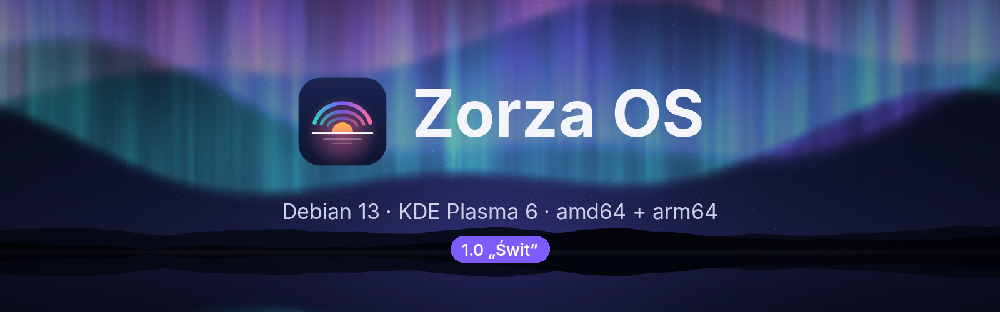

### Polski Linux na co dzień. Piękny od menu startowego po ekran logowania.

[](https://github.com/zorza-os/zorza-os/stargazers)
[](https://github.com/zorza-os/zorza-os/actions/workflows/build-iso.yml)
[](https://github.com/zorza-os/zorza-os/releases)
[](https://github.com/zorza-os/zorza-os/releases)
[](LICENSE)


[**Pobierz**](https://github.com/zorza-os/zorza-os/releases) ·
[**Strona projektu**](https://zorza-os.github.io/zorza-os/) ·
[**Podręcznik**](docs/PODRECZNIK.md) ·
[**Zgłoś błąd**](https://github.com/zorza-os/zorza-os/issues)

</div>

---

<p align="center">
  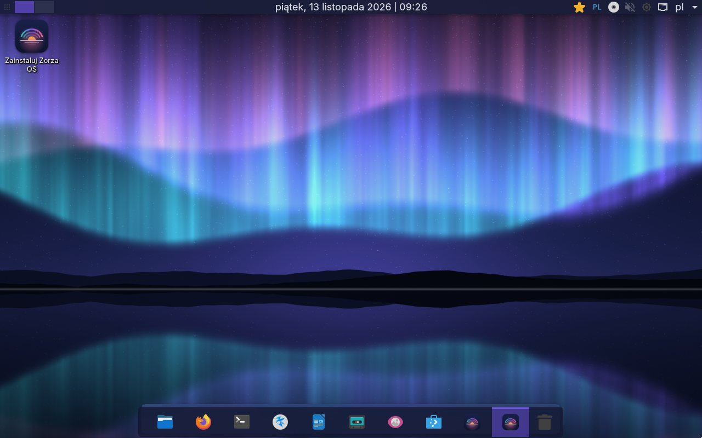
</p>

## ✨ Co to jest

**Zorza OS** to dystrybucja Linuksa zbudowana na **Debianie 13 „trixie”** i **KDE Plasma 6**. Ma własną oprawę
wizualną na każdym etapie: menu GRUB, ekran ładowania, logowanie, pulpit i instalator. Działa jako Live CD/USB
z opcją instalacji na dysk i powstaje z jednego skryptu dla dwóch architektur.

## 🖥️ Obsługiwane platformy

| Platforma | Obraz | Rozruch | Status |
|---|---|---|---|
| PC z procesorem Intel / AMD | `zorza-1.0-amd64.iso` | UEFI + legacy BIOS | ✅ przetestowany (QEMU, UEFI) |
| VirtualBox na Windows / Linux | `zorza-1.0-amd64.iso` | UEFI lub BIOS | ✅ zalecany VMSVGA, dodatki gościa w zestawie |
| Mac z Apple Silicon w **UTM** | `zorza-1.0-arm64.iso` | UEFI | 🧪 beta |
| Mac z Apple Silicon w VirtualBox 7.1+ | `zorza-1.0-arm64.iso` | UEFI | ⚠️ zależy od procesora (najnowsze układy nieobsługiwane przez VirtualBox) |
| Pendrive USB (Rufus, balenaEtcher, `dd`) | `amd64` | UEFI + BIOS | ✅ obraz hybrydowy |

## 🎨 Najważniejsze cechy

<table>
<tr>
<td width="50%" valign="top">

**Wygląd**
- motywy **Zorza Ciemny** i **Zorza Jasny**
- **6 kolorów akcentu**, także dla ikon folderów (Papirus)
- pływający dock i minimalistyczny górny pasek
- rozmycie paneli; efekty wyłączają się same bez 3D
- fonty **Inter** i **JetBrains Mono**
- **9 tapet 4K** narysowanych kodem, w tym dynamiczna **Horyzont** (świt, dzień, zmierzch, noc)

</td>
<td width="50%" valign="top">

**Wygoda**
- polski od pierwszego uruchomienia, w GRUB do wyboru **Polski / English**
- aplikacja **Witaj**: motyw, akcent, tapeta i instalacja na dysk
- **System Center**: sprzęt, wygląd i aktualizacje APT + Flatpak jednym kliknięciem
- **Discover** z Flathubem
- instalator **Calamares** z szyfrowaniem dysku
- sesja live: `live` / `live`, automatyczne logowanie

</td>
</tr>
</table>

## 📸 Zrzuty ekranu

| Menu startowe | Ekran ładowania |
|---|---|
| 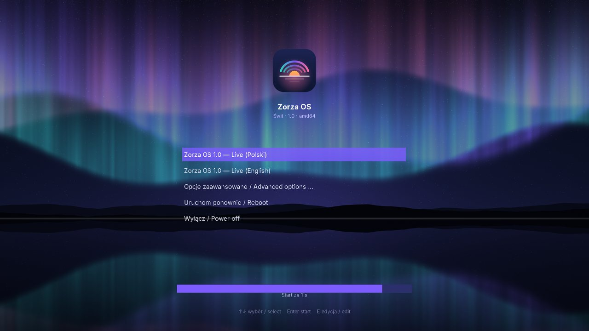 | 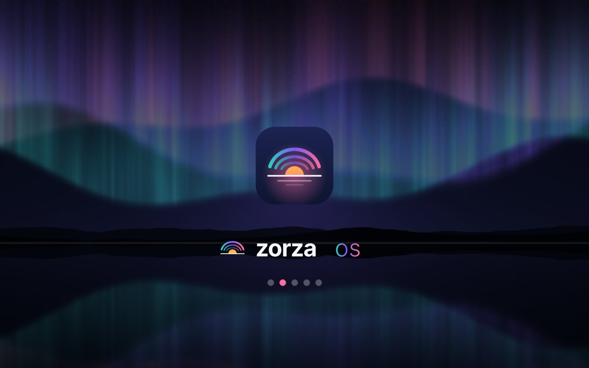 |
| **Witaj** | **System Center** |
| 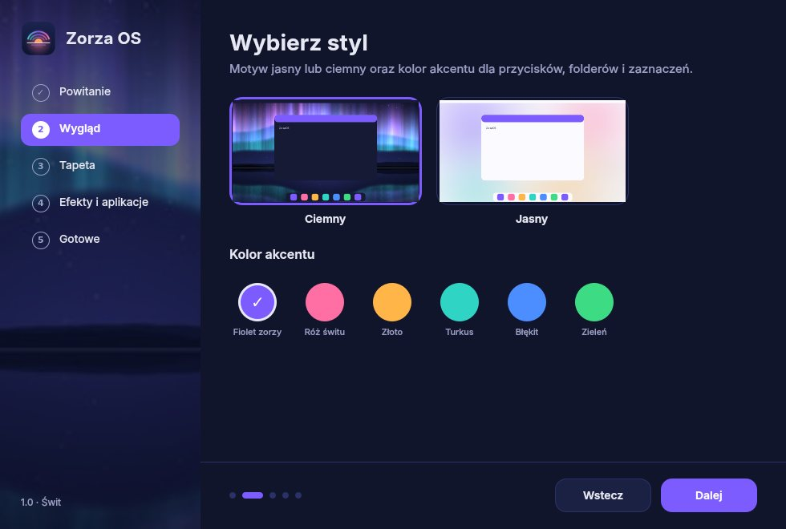 | 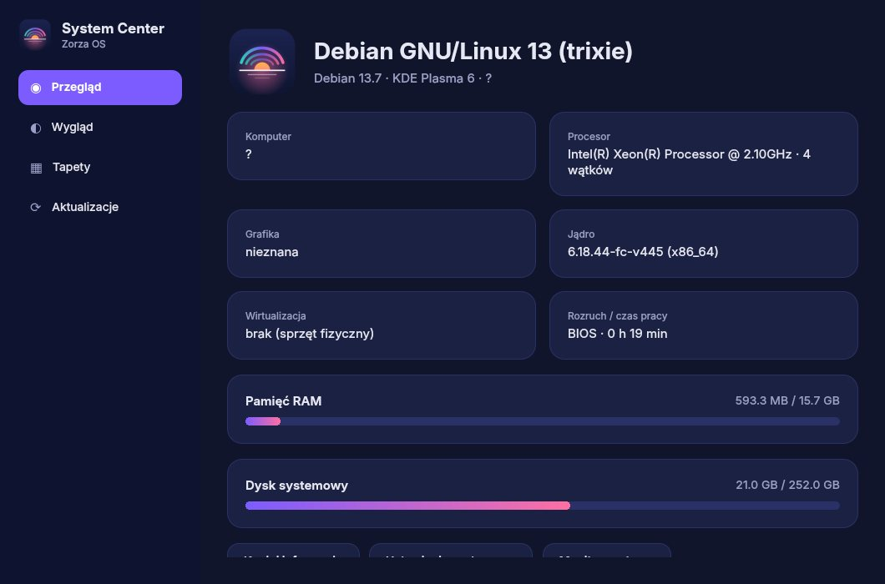 |

<details>
<summary><b>Tapety (kliknij, aby rozwinąć)</b></summary>

| | | |
|---|---|---|
| 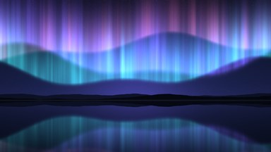 Zorza | 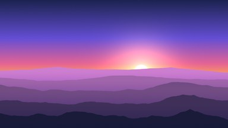 Świt | 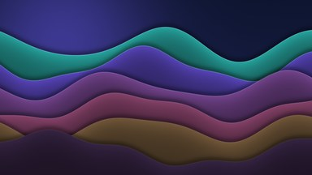 Fale |
| 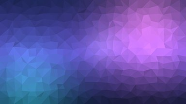 Kryształ | 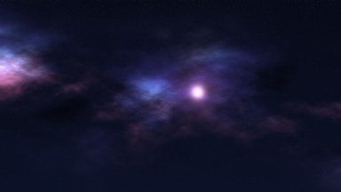 Głębia | 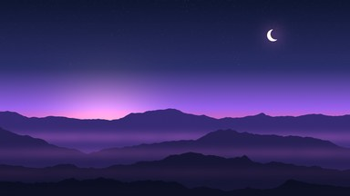 Zmierzch |
| 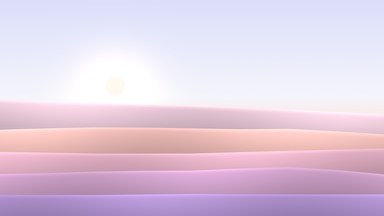 Wydmy | 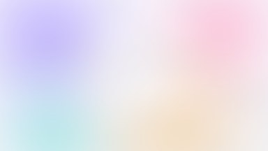 Mgła | 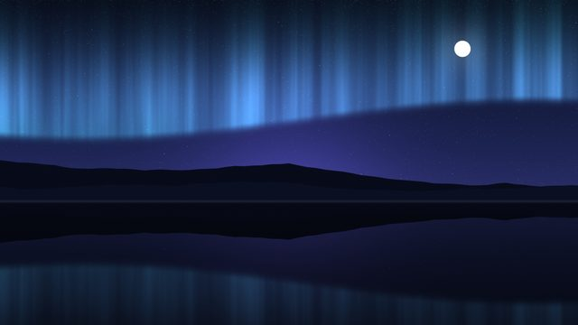 Horyzont (dynamiczna) |

</details>

## 📦 Aplikacje w zestawie

| Kategoria | Aplikacje |
|---|---|
| Internet | Firefox ESR |
| Biuro | LibreOffice, Okular, Kate |
| Grafika | GIMP, Inkscape, Gwenview, Spectacle |
| Multimedia | VLC, Elisa |
| System | Dolphin, Konsole, Ark, KCalc, Monitor systemu |
| Sklep | Discover + Flathub |

## 🚀 Szybki start

**Pobierz** gotowy obraz z zakładki [Releases](https://github.com/TechnikTOmek/zorza-os/releases) albo **zbuduj go sam**.
Potrzebujesz tylko Dockera (Linux, macOS, WSL2 na Windows):

```bash
git clone https://github.com/zorza-os/zorza-os.git
```
```bash
cd zorza-os
```
```bash
./build.command amd64
```

Na Macu wystarczy dwuklik na `build.command`. Pojawi się menu wyboru architektury. Gotowe ISO trafi do `out/`
razem z sumami SHA256.

Szczegóły (pendrive, ustawienia VirtualBox i UTM, znane ograniczenia) są w **[podręczniku](docs/PODRECZNIK.md)**.

## 🛠️ Jak to jest zbudowane

```
build.command ──► Docker (Debian 13 + live-build)
                    ├─ scripts/render-assets.py   tapety 4K, logo, motywy GRUB / Plymouth / SDDM
                    ├─ config/package-lists        pakiety (wspólne + osobne dla amd64 / arm64)
                    ├─ config/hooks                konfiguracja systemu w chroocie
                    └─ config/includes.chroot      motywy Plasmy, aplikacje Zorza, Calamares
                  ──► out/zorza-1.0-<arch>.iso
```

GitHub Actions buduje **oba obrazy równolegle** na natywnych runnerach (`ubuntu-latest` dla amd64 i
`ubuntu-24.04-arm` dla arm64). Tag `v*` tworzy szkic wydania z plikami ISO.

## 🤝 Współpraca

Zgłoszenia błędów, pomysły i pull requesty są mile widziane. Jeśli Zorza Ci się podoba,
**zostaw ⭐**. To najprostszy sposób, żeby pomóc projektowi.

[](https://star-history.com/#zorza-os/zorza-os&Date)

## 📄 Licencja

- Kod (skrypty, konfiguracja, aplikacje): **[GPL-3.0-or-later](LICENSE)**
- Grafiki (logo, tapety, motywy): **[CC BY-SA 4.0](LICENSE-ARTWORK.md)**
- Pakiety Debiana w obrazach ISO zachowują własne licencje.

<div align="center"><sub>Zorza OS nie jest powiązany z projektem Debian ani KDE e.V. Nazwy Debian i KDE należą do ich właścicieli.</sub></div>
